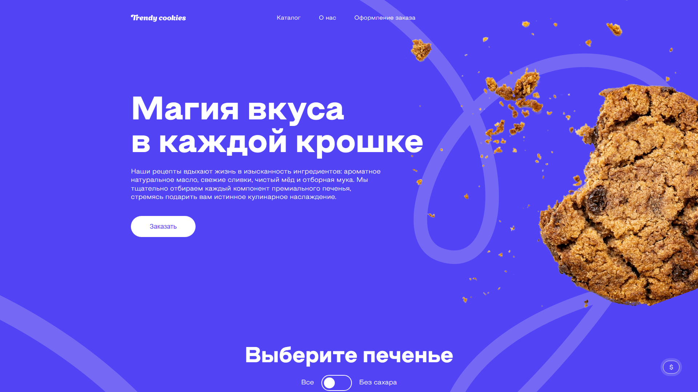
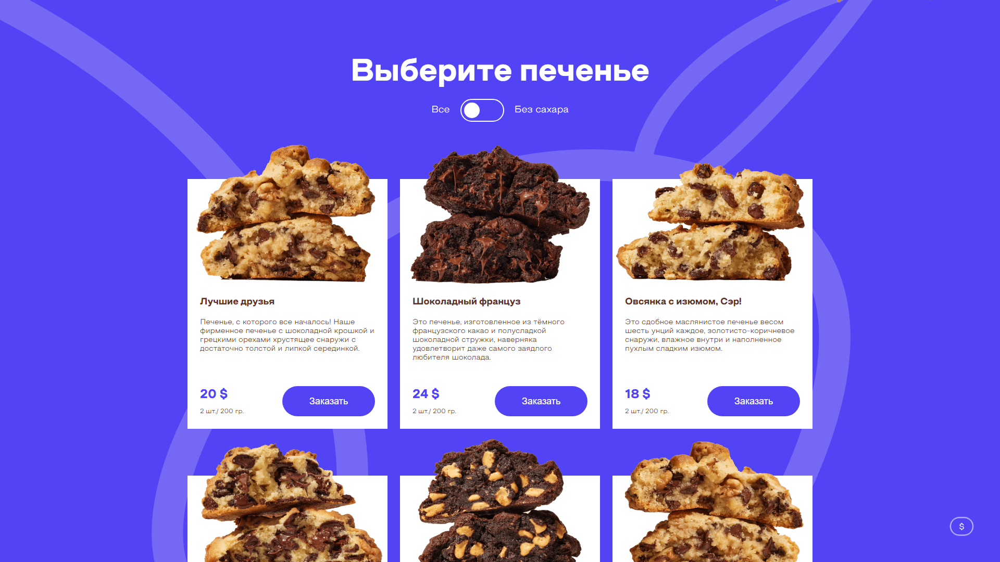
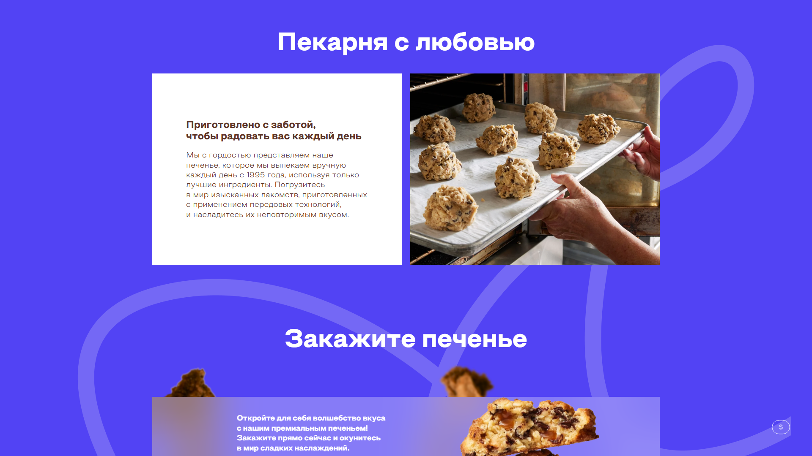
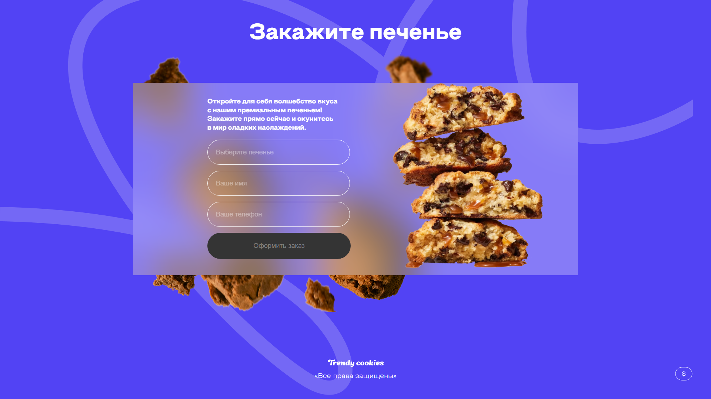
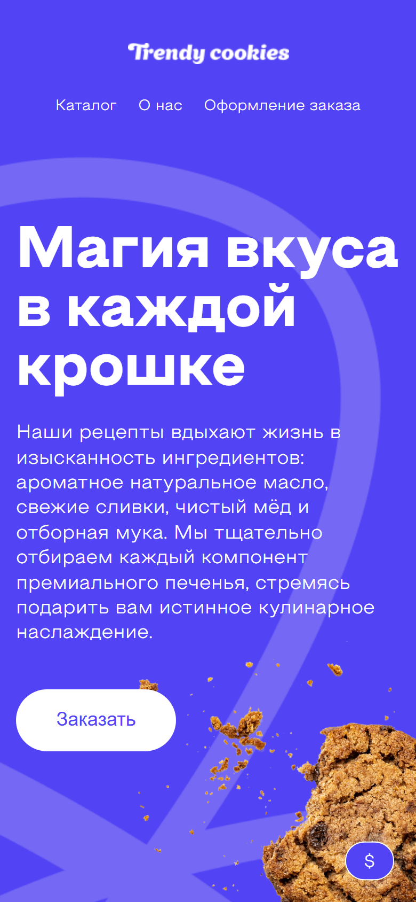

<p align="center">
  
</p>

<p align="center">
  <b>Лендинг магазина печенья Trendy cookies на Angular: каталог с сервера, фильтр «без сахара», смена валюты и форма заказа.</b>
</p>

<p align="center">
  
  
  <a href="https://dekciw.github.io/TrendyCookies/"></a>
</p>

<p align="center">
  <a href="https://dekciw.github.io/TrendyCookies/">
    
  </a>
</p>

<br>

<p align="center">
  
</p>

<br>

<table align="center">
  <tr>
    <th>&#8199;&#8199;&#8199;&#8199;&#8199;&#8199;Каталог&#8199;&#8199;&#8199;&#8199;&#8199;&#8199;</th>
    <th>&#8199;&#8199;&#8199;&#8199;&#8199;&#8199;Заказ&#8199;&#8199;&#8199;&#8199;&#8199;&#8199;</th>
    <th>&#8199;&#8199;&#8199;&#8199;&#8199;&#8199;Интерфейс&#8199;&#8199;&#8199;&#8199;&#8199;&#8199;</th>
  </tr>
  <tr>
    <td valign="top">
      - Печенье приходит с сервера<br>
      - Переключатель «Без сахара»<br>
      - Цена и вес на карточке<br>
      - Смена валюты кнопкой «$»<br>
      - $, ₽, BYN, € и ¥<br>
      - Блок «Пекарня с любовью»
    </td>
    <td valign="top">
      - Печенье, имя и телефон<br>
      - Все поля обязательны<br>
      - Отправка на тестовый сервер<br>
      - Анимация загрузки Lottie<br>
      - Кнопка «Заказать» у карточки<br>
      - Меню с якорями
    </td>
    <td valign="top">
      - Фиолетовая тема<br>
      - Адаптив до телефона<br>
      - Собственные шрифты Steppe<br>
      - Angular<br>
      - Готовая сборка проекта<br>
      - Сайт на GitHub Pages
    </td>
  </tr>
</table>

<h3 align="center">Как это выглядит</h3>

<table align="center">
  <tr>
    <td width="50%" align="center" valign="top">
      <br>
      <sub>Каталог</sub>
    </td>
    <td width="50%" align="center" valign="top">
      <br>
      <sub>Пекарня с любовью</sub>
    </td>
  </tr>
  <tr>
    <td width="50%" align="center" valign="top">
      <br>
      <sub>Заказ</sub>
    </td>
    <td width="50%" align="center" valign="top">
      <br>
      <sub>Мобильная версия</sub>
    </td>
  </tr>
</table>

<br>

<details>
<summary><b>Подробнее о проекте: устройство, запуск</b> (нажми, чтобы развернуть)</summary>

<br>

### Что в репозитории

В репозитории лежит готовая сборка Angular-приложения: `index.html`, скомпилированные скрипты `main`, `polyfills`, `runtime` и стили. Исходного кода компонентов здесь нет.

```
.
├── index.html          # страница, адрес сайта задан в <base href>
├── main.*.js           # скомпилированное приложение
├── polyfills.*.js
├── runtime.*.js
├── styles.*.css
├── assets/             # картинки, шрифты, данные и анимация Lottie
└── screenshots/        # скриншоты для README
```

### Как это работает

<p>
- <b>Каталог</b> загружается запросом <code>cookies</code>, переключатель «Без сахара» добавляет к нему параметр <code>sugarfree</code><br>
- <b>Валюта</b> переключается по кругу, цены пересчитываются от базовой цены в долларах<br>
- <b>Заказ</b> отправляется запросом <code>cookies-order</code> на учебный сервер <code>testologia.ru</code>
</p>

### Запуск

Сборка не нужна. Если открывать локально, поменяйте `<base href="/TrendyCookies/">` в `index.html` на `<base href="/">` и запустите любой локальный сервер в папке проекта.

</details>
